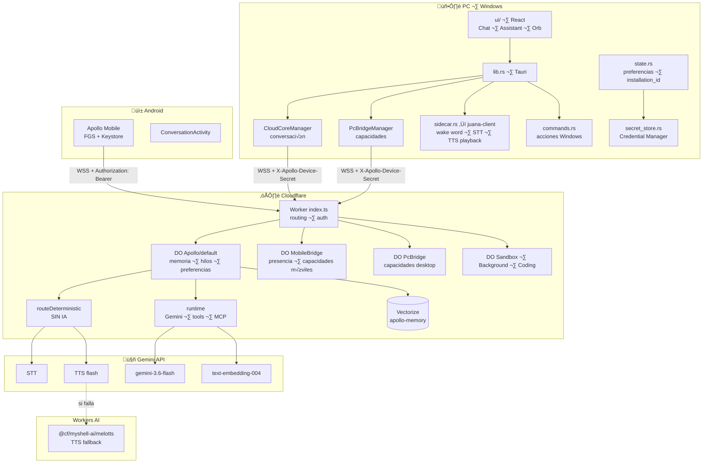
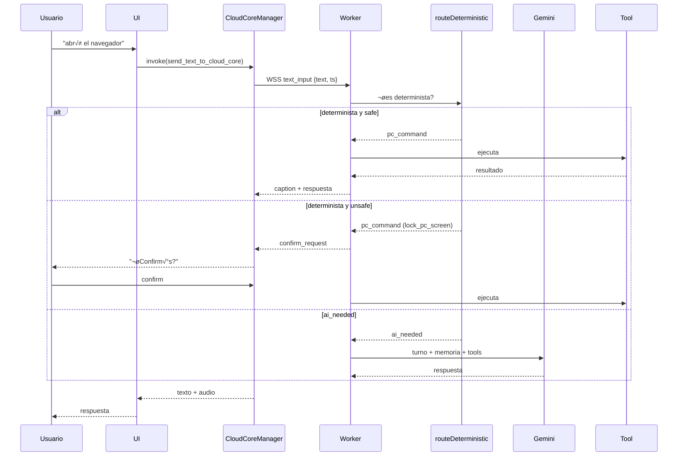

# Apollo — ARQUITECTURE

## Diagrama general



## Separación por capas

### Capa 1 · Núcleo en la nube

| Responsabilidad | Dónde |
|---|---|
API y routing | `index.ts` |
Identidad y auth | `auth/role.ts`, `auth/token.ts` |
Estado conversacional | DO Apollo (7 tablas SQL) |
Memoria sem√°ntica | Vectorize |
Herramientas | `tools/` (58 archivos) |
Integraciones | `mcp/` (16), `ota/`, `weather/`, `github/` |
Estado global | `initiativeState`, `firmware*`, `mcp_tool_settings` |

### Capa 2 · Agentes de dispositivo

| | PC | Android |
|---|---|---|
Conexión | WSS, dos sockets | WSS, uno |
Identidad | `desktop:<uuid>` persistido | `mobile:<uuid>` en Keystore |
Credencial | `X-Apollo-Device-Secret` | `Authorization: Bearer` |
Segundo plano | proceso Tauri | Foreground Service |
Ejecución | `commands.rs` | `command/dispatcher.kt` |
Confirmación | `safety: unsafe` | allowlist de comandos |

### Capa 3 · Contratos compartidos

`apps/agent/src/protocol/schema.ts` es la fuente de verdad. El cliente Kotlin replica las constantes en `contract/contract.kt`, y `apps/mobile/__tests__/contract.spec.ts` ata ambas direcciones: un cambio en un lado sin el otro **falla el build**.

## Flujo: un turno de texto



**Clave del diseño:** el router determinista corre **antes** del modelo y con contexto mínimo. Todo lo caro (memoria semántica, historial, prompt de sesión, descubrimiento MCP) se arma **solo si el turno no se resolvió ahí** (`runtime.ts:137-141`).

## Proveedor de IA — verificado por uso

| Función | Proveedor | Modelo |
|---|---|---|
Conversación | Gemini API | `gemini-3.6-flash` |
STT | Gemini API | `gemini-3.6-flash` |
TTS | Gemini API | `gemini-3.1-flash-tts-preview` |
Embeddings | Gemini API | `text-embedding-004` |
**TTS fallback** | **Workers AI** | `@cf/myshell-ai/melotts` |

El binding `AI` **no** se usa para inferencia conversacional. **Sí** se usa para el fallback de TTS (`isWorkersAiTtsAvailable`).

**Sin `GEMINI_API_KEY` no hay conversación** (`apollo.ts:2999`). No hay proveedor alternativo para conversar.

## Estado por DO

| DO | Ámbito | Nota |
|---|---|---|
`Apollo` | **Global (una instancia)** | Fuente de P2/R7: particionar por cuenta |
`MobileBridge` | **Global compartido** | Concentra presencia y capacidades de todos los teléfonos |
`PcBridge` | **Global** | Capacidades desktop |
`Sandbox`/`Background`/`Coding` | Global | Sin datos de usuario |

## Persistencia

| Dato | Ubicación | Ámbito |
|---|---|---|
`memories`, `thread_meta`, `session_prefs` | DO Apollo | Conversacional |
Vectores | Vectorize `apollo-memory` | Sem√°ntico, **global** |
`mcp_tool_settings` | DO Apollo | Configuración de instalación |
`initiativeState`, `firmware*` | `session_prefs` | Estado del agente |
Credenciales de dispositivo | `mobile_device_credential` (MobileBridge) | Por dispositivo |
`installation_id`, preferencias | JSON `app_config_dir()` | Local, no secreto |
`device_shared_secret` | **Credential Manager** | **Cifrado (DPAPI)** |

## Migración a multiusuario

Ruta objetivo:

```
/agents/apollo/<accountId>
```

Un DO por **cuenta**, no por dispositivo: si fuera por dispositivo, dos usuarios en el mismo teléfono compartirían conversación. Con DO por cuenta, el PC y el móvil de un mismo usuario **sí** comparten memoria, que es lo correcto.

Secuencia: commit de resguardo ‚Üí `.gitignore` ‚Üí tablas `account`/`session` ‚Üí DO por `accountId` ‚Üí Vectorize con filtro ‚Üí `account_id` en credenciales ‚Üí login ‚Üí cuotas ‚Üí retirar secretos globales (**irreversible**).


## ANEXO FASE 2 ó aislamiento por cuenta (implementado)

- Identidad: docs/IDENTITY-MODEL.md ó cuenta cc_<32 hex> opaca; DO Apollo/acct:<accountId>; dispositivo desktop:<uuid>/mobile:<uuid>.
- Memoria: namespace Vectorize mem:<accountId> derivado obligatoriamente de la cuenta (src/memory/vector.ts); sin cuenta o inv·lida lanza. Antes: todos compartÌan namespace 'default'.
- Aislamiento completo: docs/DATA-ISOLATION.md. MigraciÛn de Apollo/default: docs/MIGRATION-APOLLO-DEFAULT.md. DiseÒo de fase: docs/FASE-2-ARQUITECTURA-MULTIUSUARIO.md.
- Usage/cuotas: docs/USAGE-AND-QUOTAS.md ó tabla usage_events por cuenta + polÌtica configurable; enforcement en caliente pendiente.


## ANEXO FASE 2.2 ó auth + routing por cuenta (implementado)

- Sesiones reales: `docs/AUTH.md`. DO `AccountRegistry` (binding nuevo, migraciÛn v5): cuentas, sesiones (hash-only), binding device?cuenta.
- Endpoints `/api/auth/*` (register/login/logout/session/devices). La cuenta SIEMPRE sale de la sesiÛn; el `accountId` del cliente se ignora.
- Routing WebSocket: `Apollo/acct:<accountId>` con `Bearer <sessionToken>`; verificaciÛn en borde + DO; `close(1008)` si la sesiÛn no es de esa cuenta. El secreto global legacy sÛlo abre `Apollo/default`.
- Cuota pre-Gemini: el turno se rechaza (`quota_exceeded`) antes de llamar al modelo si excede polÌtica por tier.
- `memories` escribe `account_id` y sus lecturas est·n acotadas a la cuenta (NULL tolerado sÛlo en filas pre-fase de una instancia single-tenant).
